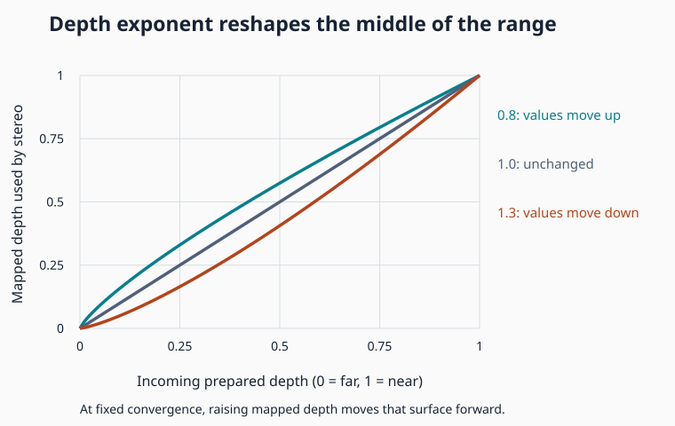

# User guide

[Back to the README](../README.md)

The strongest stereo setting is rarely the most convincing one. The useful target is clear depth with clean silhouettes, especially where a nearby subject overlaps a distant background. This guide explains how to reach that target with the controls actually implemented by this plugin.

The ranges below are **practical starting points**, not measured guarantees or universal comfort limits. Image composition, depth accuracy, output size and the way you view the result all matter. Compare at the same displayed size and make the final judgment in your intended viewer/headset.

## Start here

Use the [basic DA3 workflow](../workflows/DA3_to_SBS.json), leave its defaults alone, and inspect both the SBS and the `left`/`right` outputs. For most images:

1. Check the processed depth: nearer surfaces should generally be brighter; a foreground silhouette should follow the RGB silhouette.
2. Set divergence modestly, usually **1–2** initially.
3. Adjust convergence so the subject sits near the screen plane.
4. Increase divergence slowly. Stop when the depth feels convincing or the edges start deteriorating.
5. Tune Edge Fix and, only if necessary, repair-mask expansion. Compare against the previous result after each change.

Leave balance at **0**, separation at **0**, exponent at **1**, AA **on**, and Edge Fix at **2/2** until you have a specific reason to change them. These keep the comparison easy to interpret.

## Choose a starting recipe for the image

| Image type | Divergence | Convergence | AA / Edge Fix X,Y | What to look for |
|---|---:|---:|---|---|
| Close product, face or object against a distant background | 0.5–1.5 | Near the subject's prepared depth, often 0.6–0.9 | On; start 2,2 and compare 1,1 through 3,2 | A large near/far jump opens wide gaps around the silhouette. Prioritize clean edges over stronger depth |
| Portrait or tall image | 0.5–1.5 | Put the face/body near the screen plane | On; 1–2 each, then inspect hair | Strength uses the longest side, which is the height here. A value that worked on a landscape can be relatively strong horizontally in a portrait |
| Landscape with no nearby foreground obstruction | 1–3 | Start 0.5; use roughly 0.7–1 if you want more of the scene behind the screen | On; 1–2 each | You may tolerate more strength than a close-up, but distant layers can still have noisy or weakly estimated depth |
| Landscape with a nearby tree, railing, rock or person | 0.75–2 | Anchor the nearby important object or accept it slightly in front | On; start 2,2 | Treat the foreground silhouette like a close-up, even if most of the frame is distant scenery |
| Interior, architecture or a hallway | 1–2 | Choose a door, wall or main object as the screen plane | On; 1–2 each | Straight lines reveal misalignment and stretched fills. Increase DA3 detail if thin edges are misplaced |
| Foliage, hair, fences, wires, transparent objects | 0.5–1.25 | Anchor the main opaque subject | On; compare 0,0 / 1,1 / 2,2 | Fine structures and transparency are difficult depth inputs. Too much edge expansion can merge or thicken them |

These are starting recipes for **prepared near-white disparity**, not rules derived from physical camera distance. A subject may have depth 0.45 rather than 0.8 in a particular image. Use its actual prepared depth to place it at the screen plane.

With no nearby foreground, increasing strength can separate distant layers perceptually, but it cannot add detail missing from a flat or inaccurate depth map. A more detailed DA3 estimate may help more than a large divergence increase.

## What the stereo controls actually do

### Divergence: how far the eyes move apart

`divergence` controls total stereo disparity as a **percentage of the longest image side**. At balance zero, the work is split equally between the eyes. It is not a percentage applied independently to each eye.

For the default exponent, zero separation and balanced eyes:

```text
per-eye horizontal shift = longest_side × divergence / 200 × (depth − convergence)
left shifts by +shift; right shifts by −shift
```

Nearer prepared depth is larger. At convergence 0.5, pixels above 0.5 move toward in-front-of-screen disparity; pixels below it move toward behind-screen disparity in a correctly ordered left-right viewer.

For a 1600×900 image, divergence 2, and convergence 0.5:

| Prepared depth | Left shift | Right shift | Interpretation |
|---:|---:|---:|---|
| 0.0 | −8 px | +8 px | Behind screen |
| 0.5 | 0 px | 0 px | At screen plane |
| 1.0 | +8 px | −8 px | In front of screen |

At divergence 6 those shifts triple. The gaps at a depth discontinuity grow with divergence too: for a depth jump of 0.8 in this 1600-wide example, the per-eye displacement difference is approximately **12.8 pixels at 2**, and **38.4 pixels at 6**. Those are geometric displacement differences, not a promise of the exact final hole width after splatting, padding and overlap correction.

That explains why a small inpainting model can look excellent at a modest strength and begin to show invented texture or doubled-looking contours at higher strengths. It is being asked to fill much more missing background.

**Useful range:** start 1–2; try 0.5–1.5 for difficult close-ups; explore 2–3 on clean scenes. Values above 3 can be useful for experimentation but make depth errors and missing content increasingly visible. The node permits 0–15; the slider limit is not a quality recommendation. Zero removes depth-dependent displacement; nonzero separation can still shift the views.

### Convergence: where the screen plane cuts the scene

`convergence` is the prepared depth value placed at zero disparity, after the exponent. It changes the scene's position relative to the screen rather than changing its internal near/far spacing.

- Raise convergence: more of the scene moves **behind** the screen.
- Lower convergence: more of the scene moves **in front** of the screen.
- Set it near your subject's depth: the subject has little horizontal offset while foreground/background remain separated.
- Set it to 1: all ordinary normalized depth is at or behind the screen when separation is zero.
- Set it to 0: all ordinary normalized depth is at or in front of the screen when separation is zero.

**Useful range:** 0.3–0.7 is a good exploration range; 0.6–0.9 can anchor a near subject; 0.7–1 can keep a landscape mostly behind the screen. These numbers depend on the map, not on whether an object is physically a certain distance away.

For a close object, placing that object near the screen plane can reduce its absolute displacement and help the composition. It **does not remove the disparity jump between the object and its background**. Lower divergence is the direct way to reduce that jump and the resulting disocclusions.

If an object touches the image border while appearing to project in front of the screen, its apparent crop can feel awkward. Try placing it nearer the screen plane or farther behind it. Convergence cannot reconstruct what lies outside the original photograph.

### Balance: how the synthesis is shared

`balance` distributes the same total disparity between eyes:

| Balance | Left eye | Right eye |
|---:|---|---|
| 0 | Half of the total displacement | Half of the total displacement |
| +0.5 | 75% | 25% |
| −0.5 | 25% | 75% |
| +1 | Fully synthesized | Original |
| −1 | Original | Fully synthesized |

**Recommended default:** 0. Try small offsets around −0.25 to +0.25 if one eye's artifacts are more objectionable or you have a composition-specific preference. Use ±1 mainly for comparison or when retaining an original eye is intentional.

Single-eye synthesis is not a free reduction in artifacts: it concentrates the full displacement into one eye, making that eye's gaps larger than in the balanced case. The eyes retain their left/right meaning; changing balance is not the same as swapping the output order.

### Separation: an additional constant stereo offset

`separation` shifts the eyes apart independently of local depth. With balance zero, it is a per-eye percentage of the longest side: positive values move the left image leftward and the right image rightward, pushing the scene toward behind-screen disparity.

Leave it at **0** when tuning convergence. If needed, try very small steps such as **±0.05 to ±0.2**. At 1600 pixels, separation 0.1 adds 1.6 pixels of offset per eye. Large values mostly create border demands and can make viewing difficult; the available −5 to +5 range is not a sensible default range.

For nonzero divergence, its effect on the screen plane is equivalent to adding `2 × separation / divergence` to convergence. At divergence 2, separation 0.1 is therefore equivalent to raising convergence by 0.1. Usually pick **one** of these controls to position the scene. Neither reduces the internal disparity jump at a silhouette.

At nonzero balance the constant shift follows the same eye distribution as the depth shift. It is applied before geometric masks are calculated, not as an image translation after filling.

### Depth exponent: reshape depth distribution

The stereo node transforms prepared depth with `depth ** depth_exponent` before subtracting convergence. Its default of **1** leaves the distribution unchanged.

- Less than 1 raises intermediate depth values: at fixed convergence, intermediate surfaces move toward the front.
- Greater than 1 lowers intermediate depth values: at fixed convergence, intermediate surfaces move toward the back.
- Endpoints 0 and 1 remain the endpoints. This is a redistribution of depth, not a uniform strength multiplier.



**Useful range:** leave at 1 initially; try **0.8–1.3** for a deliberate depth-distribution change. For example, if mid-distance terrain feels compressed into the background, a value below 1 can bring those values forward, but it also changes the apparent position and spacing of other intermediate surfaces. It is not a replacement for a correct map.

Readjust convergence after changing the exponent. If the subject's prepared value is 0.7 and the exponent is 1.3, its screen-plane value is now approximately 0.63. The graph's horizontal axis is incoming prepared depth; the vertical axis is the depth used by the warp.

The implementation clamps to [0,1] before a nonidentity fractional power, because AA can produce small overshoot. With exponent 1, that extra clamp is not applied. This mapping differs from ComfyStereo's signed power of an already centered offset, so equal exponent values are not necessarily equivalent between plugins.

### Method: neural inpainting or simple fill

**forward_inpaint** is the normal choice. It forward-warps the RGB image with depth ordering, derives geometric gap masks, prepares eye-oriented repair regions, and uses iw3's lightweight still-image model to repair them.

**forward_fill** uses the same upstream forward geometry with simple directional shifting/fill. Use it to compare the underlying warp or diagnose whether neural repair is making a particular area worse. It may stretch background or produce obvious repeated texture. Repair-mask dilation settings do not change this method's output.

Both retain full image dimensions. The image network uses internal feature downscaling and padding; that does not shrink the exported eyes. This pack does not expose a lower-resolution whole-image inpainting shortcut.

## Depth preparation and edge controls

### Raw DA3 geometry versus a rendered map

The preferred connection is **DA3Inference → iw3 Depth from DA3 Geometry**. The built-in DA3 output is raw distance with optional sky probabilities, not an ordinary near-white disparity image.

The adapter follows iw3's DA3 conversion: inverse distance with a +0.2 shift, sky weighting, optional inversion, learned AA, Edge Fix, then min/max normalization. The resulting preview is generally white near / black far. The sky treatment is automatic when the geometry includes sky probabilities; there is no separate sky-threshold control in this pack.

`DA3Render` grayscale output is already a visualization transform. A typical `v2_style` or `min_max` near-white render should use **iw3 Depth from Grayscale Image → normalized_disparity**. Do not choose raw distance and take its reciprocal again. An 8-bit rendered map also loses depth precision compared with raw geometry.

### Depth Anti-aliasing

`depth_aa` runs the upstream learned DepthAA model **before Edge Fix**. It can improve jagged depth boundaries and reduce stair-step artifacts that become visible when the image is displaced horizontally. It is not RGB anti-aliasing or a blur applied to the finished SBS.

**Recommended default:** on. Compare on/off for already processed maps or exceptionally thin structures. It cannot recover an occluded background or correct a badly misplaced boundary by itself.

The built-in DA3 node returns depth already upsampled to the original image size. AA therefore processes that supplied tensor. It may not look identical to applying AA inside iw3's own estimation frontend before a different upsampling/TTA sequence. Avoid applying the same AA stage twice.

### Edge Fix X and Y

`edge_fix_x` and `edge_fix_y` are **iteration counts at the depth input resolution**, not percentages, edge thresholds, or hole-mask widths. Each iteration combines Gaussian smoothing, edge weighting and foreground-depth dilation. This broadens near-depth support around selected boundaries before the image is warped.

- X controls additional horizontal processing. It often matters at vertical silhouettes because the stereo displacement is horizontal.
- Y controls vertical processing. It can help stair-stepped or irregular boundaries, but excessive Y expansion can thicken horizontal edges or small structures.
- Equal values use shared 3×3 iterations; extra X/Y iterations use 1×3 / 3×1 operations.
- 0/0 disables the stage.

**Useful range:** start **2/2**; compare **1/1**, **2/1**, **3/1** or **3/2** when tuning. Values around 0–4 are the useful first experiments, despite a 0–20 UI range. For fine hair or fences, compare 0/0 against 1/1 before increasing it.

If a person has a background-colored fringe or a near-depth silhouette that is slightly too narrow, a little more X may help. If their outline becomes thick, smudged or detached from the image, reduce it. Edge Fix adjusts depth support; it is not an instruction to the inpainting model to use a larger mask.

The same iteration count covers a smaller fraction of a higher-resolution input. Start from the defaults after changing image/depth dimensions rather than assuming a previous setting has the same perceptual effect. No fixed count guarantees improvement.

### Distance shift

In the raw-distance conversion, disparity begins as `1 / (distance + distance_shift)`. **0.2 is the iw3 DA3 reference default.** Leave it there unless you are intentionally changing the depth curve.

The effect depends on the scale of the raw distances. Increasing the shift flattens the reciprocal before normalization; after min/max normalization, intermediate depths move closer to the near endpoint relative to an unshifted reciprocal. It does not simply reduce every object's final disparity by the same amount.

For an experiment with DA3 Mono, try **0.1–0.5**, then inspect the prepared map and reset convergence. This is a diagnostic range in that model's relative units, not a physical distance recommendation. DA3 Metric and other distance sources may use a different scale. Larger values are not a general fix for strong foreground artifacts; reduce divergence first.

This setting is only read for the `distance` convention or raw DA3 geometry. It does nothing to normalized-disparity and inverse-depth inputs. Zero distance with a zero shift is rejected rather than divided by zero.

### Invert depth

Leave `invert_depth` **off** for normal built-in DA3 geometry and normalized near-white maps. Turn it on only if the intended depth order is reversed after choosing the correct input convention.

For normalized inputs it uses `1-depth`. For raw values it reflects the converted disparity around its per-image minimum/maximum before processing. This reverses depth order; it is not a subtle stereo-strength control. Wrong eye order can also make depth appear reversed, so check `layout` before changing a physically plausible map.

### Grayscale convention and normalization

| Convention | Input meaning | Normalize |
|---|---|---|
| normalized_disparity | Values in [0,1], near white | Usually off |
| normalized_far | Values in [0,1], far white; linearly inverted | Usually off |
| inverse_depth | Raw nonnegative inverse distance / disparity | Required on |
| distance | Raw nonnegative distance, converted with reciprocal + shift | Required on |

`normalize` applies per-image min/max scaling **after AA and Edge Fix**. It is not histogram equalization or percentile clipping. For a deliberately normalized map, leave it off to retain its chosen depth distribution; turn it on if you explicitly want the processed range stretched to [0,1]. A map restricted to [0.3,0.7] becomes substantially stronger if normalized to [0,1].

When normalization is off, AA's small output overshoot is retained; this follows the model rather than silently renormalizing a second time. A constant map has no range to stretch: the implementation follows iw3's preserve/clamp behavior and treats it as a plane. It does not invent depth for a flat map.

Do not pass a colored depth visualization, sky mask or confidence image as depth. Colorized input is rejected. Raw NaN/infinite values and invalid negative raw depth also produce errors. Export raw geometry or a genuine grayscale map instead of trying to infer depth from a colormap.

### DA3 resolution and resize method

These belong to the built-in **Run Depth Anything 3** node rather than the stereo plugin, but they often determine the best improvement you can make.

- **504 / upper_bound_resize** is a practical initial setting: it limits the longest estimation side and keeps memory use modest.
- Try roughly **700–1008**, in multiples of 14, for difficult subjects or fine boundaries if memory permits. More resolution costs computation and memory and does not guarantee a better estimate.
- `lower_bound_resize` sizes by the shortest side. It can preserve more detail in wide/tall images, but can process far more pixels than the same numeric upper-bound setting. For a 1600×900 image, a lower-bound target near 896 is approximately full-image estimation, not a modest 896-long-side pass.

The node upsamples depth back to source dimensions. Stereo output resolution stays full-size even when estimation runs smaller. Inspect alignment on the real subject, especially hair, branches and foreground rocks, before attributing every artifact to inpainting.

## Repair-mask controls

`mask_inner_dilation` and `mask_outer_dilation` enlarge the region supplied to the neural repair model after geometric holes are identified. They do not improve the depth estimate and they do not create more source background.

The convention is easiest to understand on a right-eye view of a simple nearer foreground object: the newly revealed background gap is typically on its right side. The upstream right-view mask orientation extends **inner** toward the foreground-side edge (left in this simple case), and **outer** toward the background-side edge (right). The left eye is flipped into that same working orientation and flipped back afterward. These are directional controls, not a uniform dilation around every object; complicated geometry can have less intuitive local boundaries.

**Useful range:** start **0/0**, then try **1–2** for one control at a time. Consider inner expansion if contaminated foreground-edge pixels remain at the gap boundary; consider outer expansion if the transition into nearby background remains visibly broken. Compare rather than assuming a particular direction must be better for every edge.

Larger masks replace more valid content and may increase blur or hallucinated texture. If a detail is being eaten away, reset both to zero before increasing other settings. The model already expands/blends its repair boundary with a 15-tap Gaussian, so even zero dilation does not mean a hard seam.

Counts are scaled by output width relative to the incoming depth width. With the normal aligned, full-size DA3 geometry they approximately correspond to output pixels. When explicitly resizing lower-resolution depth, the scaling matters. In `forward_fill` mode these controls are inactive.

## Outputs and masks

| Output | Meaning |
|---|---|
| stereo | Images packed according to `layout` |
| left / right | Full-resolution named eye views, independent of packing order |
| left_gap / right_gap | Binary geometric undefined and corrected layered-hole regions before mask closing, expansion and model blur |
| left_repair / right_repair | Final soft compositing region used by the neural model; white is full repair, gray is partial blending |
| processed_depth | The preparation node's near-white depth preview before the stereo exponent |

**White means needs repair. Black RGB does not mean a hole.** Coverage comes from upstream warp sentinels and geometry; actual black content remains valid. The raw masks merge both fully uncovered and invalidated layered samples into white. A zero mask for an unsynthesized eye means no repair was required there.

For `forward_fill`, repair-mask outputs equal the raw gap masks; they identify the regions filled by the simple method. They do not describe a neural blending operation in that mode.

Use **Convert Mask to Image** and Preview/Save Image to inspect a mask. Use masks downstream if you want an additional automatic repair step, but be aware that a separate inpainting pass may produce inconsistent detail between eyes.

### Layout

- **left-right**: standard parallel-view SBS; W×H source becomes **2W×H**.
- **right-left**: reversed SBS for a crossed-view or a player expecting that order.
- **top-bottom / bottom-top**: vertical packing, **W×2H**.
- **red-cyan-anaglyph**: left red plus right green/blue, **W×H**. Simple channel packing can alter colors; this is not a color-corrected anaglyph transform.

Named `left` and `right` outputs are never swapped by layout. Export those if your player or downstream workflow assembles its own stereo format. This plugin has no player, headset integration or display crosstalk correction.

## Alignment, device and downloads

`depth_resize=require_aligned` checks matching image/depth dimensions. Keep it as the default. `resize_bilinear` explicitly allows a differently sized map and uses the upstream antialiased bilinear resize. The source and depth must still describe the **same crop and field of view**; resizing cannot repair a depth map generated from another crop or frame. A single map can broadcast across an image batch, but is only semantically correct when it fits those images.

`device=auto` uses ComfyUI's selected processing device; `cpu` forces CPU. Keep auto normally. CPU can be useful when GPU memory is scarce but is slower. Model loading and offload use ComfyUI's normal model management, and images/eyes process sequentially to limit peak memory. Large images can still exhaust memory; the plugin does not silently lower output resolution. Other accelerators have not been validated here.

`download_missing` permits first-use downloading of the two official iw3 checkpoints. Leave it on for a connected setup, or place the documented files in `models/iw3` and turn it off for offline use. The loader verifies hashes and caches model objects through normal node execution. It downloads neither a DA3 estimator nor unrelated video/inpainting models.

## Troubleshooting ghosting and rough edges

| Symptom | First change | Why |
|---|---|---|
| Double-looking contour or smeared texture visible in a separate eye | Reduce divergence; inspect depth alignment; compare AA and Edge Fix | Wider gaps amplify depth error and ask the model to invent more background |
| Separate eyes look clean but stereo viewing shows another faint eye image | Check viewer eye order, scaling and display crosstalk | Filling cannot correct an optical/display artifact |
| Bright/background fringe around a close subject | Compare Edge Fix X 1–3; verify the subject's depth silhouette | Foreground depth support may not match RGB coverage |
| Subject outline looks swollen or fine branches disappear | Reduce Edge Fix and reset mask dilations | Processing may be broadening the foreground or replacing too much detail |
| Jagged/stair-step boundary | Enable AA; inspect DA3 resolution | A coarse boundary becomes more visible after horizontal displacement |
| Stretched repeated texture | Check whether method is forward_fill; switch to forward_inpaint | Simple directional fill copies pixels rather than synthesizing detail |
| Depth feels reversed | Check output layout and depth convention | A swapped eye order or inverted map reverses perceived geometry |
| Whole scene feels too far forward/back | Adjust convergence with separation zero | This repositions the screen plane without changing depth spread |
| Scene feels flat | Check prepared depth variation, then modestly raise divergence | A constant/poor map cannot yield meaningful internal depth |

A doubled edge can come from the depth boundary, the repair blend, the model's invented content, or the viewer. It is plausible that the small inpainting model is the limiting factor at high divergence, but inspect the separate eyes before concluding that model size alone is responsible.

For a difficult close-up, use this comparison sequence: divergence **1**, convergence near subject depth, balance **0**, separation **0**, exponent **1**, AA **on**, Edge Fix **2/2**, dilations **0/0**. Then compare **1/1** and **3/2**, followed by AA off if needed. Only after choosing the cleanest edge settings should you raise divergence. Keep the same input and estimation settings throughout that comparison.

The method cannot reconstruct the true hidden background from a single image and depth map. If you need stronger depth than the scene supports cleanly, the practical choices are accepting more synthesized detail, reducing strength, improving the depth input, or choosing an image with less foreground occlusion.
